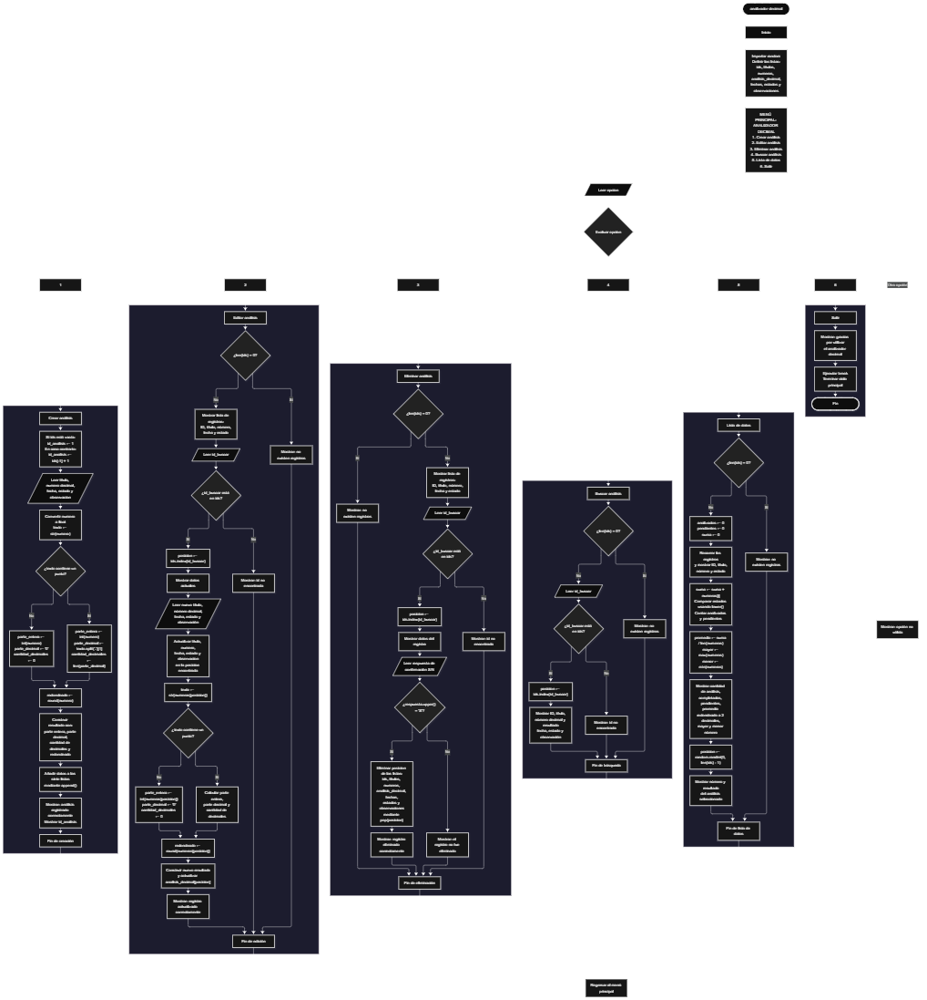

 

Este proyecto, llamado <b>analizador decimal</b>, fue desarrollado en <b>python</b> como un ejercicio práctico para fortalecer la lógica de programación mediante la creación de un sistema de gestión y análisis de números decimales desde la consola. El programa cuenta con un menú principal de seis opciones que permite <b>crear, editar, eliminar, buscar y consultar análisis numéricos</b>, además de mostrar estadísticas generales de los registros almacenados. Cada análisis contiene un identificador, un título, un número decimal, el resultado del análisis, una fecha, un estado y una observación. Para organizar la información, se utilizan listas paralelas que mantienen relacionados los datos de cada registro durante la ejecución del programa. El análisis numérico permite obtener la parte entera, la parte decimal, la cantidad de cifras decimales y el número redondeado. Durante su desarrollo se aplicaron conceptos fundamentales de programación, como variables, listas, estructuras condicionales, ciclos repetitivos, conversiones de tipos de datos, operaciones con cadenas, búsqueda de registros, cálculos estadísticos y selección aleatoria. Este proyecto permite poner en práctica los conocimientos adquiridos en python y sirve como base para desarrollar sistemas de análisis numérico más avanzados.

<h2 align="center">⚙️ Funcionamiento del menú principal</h2>

### ➕ Crear análisis

La opción <b>1) crear análisis</b> permite registrar un nuevo análisis numérico. Antes de realizar el registro, el programa determina el identificador que se asignará al análisis mediante la lista <b>ids</b>. Si no existen registros, el identificador comienza en <b>1</b>; de lo contrario, se obtiene sumando uno al último identificador almacenado mediante la expresión <b>ids[-1] + 1</b>. Después, solicita el <b>título, número decimal, fecha, estado y observación</b> del análisis. El número introducido se convierte a tipo <b>float</b> para realizar las operaciones numéricas. Posteriormente, se transforma en texto mediante <b>str()</b> y se comprueba si contiene un punto decimal. Si lo contiene, se obtiene la parte entera mediante <b>int()</b>, se extrae la parte decimal utilizando <b>split(".")</b> y se calcula la cantidad de cifras decimales con <b>len()</b>. Si no contiene un punto decimal en su representación textual, la parte decimal se establece como <b>"0"</b> y la cantidad de decimales como <b>0</b>. A continuación, se obtiene el número redondeado mediante <b>round()</b> y se construye una cadena con los resultados: parte entera, parte decimal, cantidad de decimales y número redondeado. Finalmente, los datos se almacenan en las listas correspondientes mediante <b>append()</b> y se muestran los mensajes <b>"análisis registrado correctamente."</b> y el identificador asignado al nuevo registro.

### ✏️ Editar análisis

La opción <b>2) editar análisis</b> permite modificar la información de un análisis registrado. Primero, el programa comprueba si existen registros mediante la condición <b>len(ids) == 0</b>. Si no hay datos almacenados, muestra el mensaje <b>"no existen registros."</b>. En caso contrario, recorre la lista de identificadores y presenta un resumen de cada análisis con su ID, título, número decimal, fecha y estado. Después, solicita el identificador del registro que se desea editar y comprueba si existe en la lista <b>ids</b>. Si lo encuentra, utiliza <b>index()</b> para determinar su posición y muestra los datos actuales. A continuación, solicita el nuevo título, número decimal, fecha, estado y observación, actualizando los valores de las listas correspondientes sin modificar el identificador original. Como el número puede cambiar, el programa vuelve a calcular la parte entera, la parte decimal, la cantidad de cifras decimales y el número redondeado, construyendo nuevamente la cadena de resultados y actualizando la posición correspondiente de <b>analisis_decimal</b>. Finalmente, muestra el mensaje <b>"registro actualizado correctamente."</b>. Si el identificador introducido no existe, presenta el mensaje <b>"id no encontrada."</b>.

### 🗑️ Eliminar análisis

La opción <b>3) eliminar análisis</b> permite eliminar un análisis registrado mediante su identificador. Antes de comenzar, el programa comprueba si existen registros. Si las listas están vacías, muestra el mensaje <b>"no existen registros."</b>. Si hay información disponible, presenta un resumen de los análisis registrados y solicita el ID del registro que se desea eliminar. Cuando encuentra el identificador, obtiene su posición mediante <b>index()</b> y muestra los datos del análisis seleccionado. Después, solicita una confirmación mediante la pregunta <b>"¿desea eliminar este registro? (s/n):"</b>. Si la respuesta, convertida a mayúsculas mediante <b>upper()</b>, es igual a <b>"S"</b>, el programa elimina los datos de esa posición en las siete listas mediante el método <b>pop()</b>: <b>ids, titulos, numeros, analisis_decimal, fechas, estados y observaciones</b>. De esta manera, mantiene la correspondencia entre los datos de cada registro. Finalmente, muestra el mensaje <b>"registro eliminado correctamente."</b>. Si el usuario no confirma la eliminación, presenta el mensaje <b>"el registro no fue eliminado."</b>. Si el ID no existe, muestra el mensaje <b>"id no encontrada."</b>.

### 🔎 Buscar análisis

La opción <b>4) buscar análisis</b> permite localizar un registro mediante su identificador. Primero, el programa comprueba si existen análisis almacenados. Si no hay registros, muestra el mensaje <b>"no existen registros."</b>. En caso contrario, solicita el ID que se desea buscar y comprueba si está presente en la lista <b>ids</b>. Cuando encuentra una coincidencia, utiliza <b>index()</b> para obtener la posición del registro y mostrar toda su información: <b>identificador, título, número decimal, resultado del análisis, fecha, estado y observación</b>. El resultado presenta la parte entera, la parte decimal, la cantidad de decimales y el número redondeado que se calcularon durante el registro o la última edición. Si el identificador introducido no corresponde a ningún registro, el programa muestra el mensaje <b>"id no encontrada."</b>. Esta función permite consultar individualmente los análisis sin necesidad de recorrer manualmente todos los datos.

### 📋 Lista de datos

La opción <b>5) lista de datos</b> permite visualizar un resumen de los análisis registrados y obtener estadísticas generales de los números decimales. Antes de comenzar, el programa comprueba si existen registros. Si no hay información almacenada, muestra el mensaje <b>"no existen registros."</b>. Si existen datos, inicializa las variables <b>analizados, pendientes y suma</b> en cero y recorre los registros mediante un ciclo <b>for</b>. Durante el recorrido, muestra el ID, el título, el número decimal y el estado de cada análisis. También acumula los números en la variable <b>suma</b> y cuenta los registros cuyo estado, convertido a minúsculas mediante <b>lower()</b>, coincide con <b>"analizado"</b> o <b>"pendiente"</b>. Una vez finalizado el recorrido, calcula el promedio dividiendo la suma entre la cantidad de números almacenados mediante <b>suma / len(numeros)</b>. Además, obtiene el número mayor con <b>max()</b> y el menor con <b>min()</b>. El promedio se muestra redondeado a dos cifras decimales mediante <b>round(promedio, 2)</b>. Finalmente, el programa selecciona una posición aleatoria utilizando <b>random.randint(0, len(ids) - 1)</b> y presenta el número decimal y el resultado del análisis correspondiente. Esta opción reúne el listado de registros, el conteo de estados, las estadísticas numéricas y una selección aleatoria de los análisis disponibles.

### 🚪 Salir del menú principal

La opción <b>6) salir</b> permite finalizar la ejecución del programa. El menú principal se encuentra dentro de un ciclo repetitivo <b>while True</b>, que mantiene el sistema en funcionamiento mientras el usuario selecciona las diferentes operaciones disponibles. Cuando se introduce la opción <b>"6"</b>, el programa muestra el mensaje <b>"gracias por utilizar el analizador decimal."</b> y ejecuta la instrucción <b>break</b>, que interrumpe el ciclo y termina el menú principal. Si el usuario introduce una opción diferente de las comprendidas entre <b>1</b> y <b>6</b>, el programa muestra el mensaje <b>"opción no válida."</b> y vuelve a presentar el menú. Es importante tener en cuenta que los registros se almacenan en listas de memoria, por lo que no se conservan automáticamente cuando finaliza la ejecución del programa.

<h2 align="center">🧠 Temas aplicados en el proyecto</h2>

### 📦 Variables

En este proyecto se utilizan variables para controlar las opciones del menú, almacenar los datos introducidos por el usuario, calcular los resultados del análisis decimal, localizar registros, obtener estadísticas y seleccionar un análisis aleatorio. Cada variable cumple una función específica dentro de las operaciones del sistema. Algunas se utilizan durante la creación y edición de los registros, mientras que otras permiten realizar cálculos numéricos y controlar los recorridos de las listas.

🔢 **Opcion:** Almacena la opción seleccionada por el usuario en el menú principal.

🆔 **Id_analisis:** Almacena el identificador que se asigna al nuevo análisis.

🔎 **Id_buscar:** Almacena el identificador introducido para localizar un registro durante las operaciones de edición, eliminación o búsqueda.

📍 **Posicion:** Guarda el índice del registro localizado dentro de las listas.

🔢 **Numero:** Almacena el número decimal introducido durante la creación de un análisis.

🧮 **Texto:** Contiene la representación textual del número decimal, utilizada para identificar el punto decimal y extraer la parte decimal.

🔢 **Parte_entera:** Almacena la parte entera obtenida mediante la conversión del número a un valor entero.

🔣 **Parte_decimal:** Almacena las cifras que aparecen después del punto decimal en la representación textual del número.

📏 **Cantidad_decimales:** Guarda la cantidad de caracteres de la parte decimal obtenida mediante la función `len()`.

🔄 **Redondeado:** Almacena el resultado de aplicar la función `round()` al número decimal.

📝 **Resultado:** Construye la cadena que contiene la parte entera, la parte decimal, la cantidad de decimales y el número redondeado.

📊 **Analizados:** Cuenta los registros cuyo estado es igual a `analizado`, sin distinguir entre mayúsculas y minúsculas.

⏳ **Pendientes:** Cuenta los registros cuyo estado es igual a `pendiente`, sin distinguir entre mayúsculas y minúsculas.

➕ **Suma:** Acumula los números decimales para calcular el promedio.

📈 **Promedio:** Almacena el promedio de los números registrados.

🔢 **Mayor:** Representa el número decimal más alto de la lista.

🔢 **Menor:** Representa el número decimal más bajo de la lista.

🔄 **I:** Funciona como contador en los ciclos `for` que recorren los registros.

🎲 **Posicion:** También se utiliza para seleccionar aleatoriamente uno de los análisis registrados mediante `random.randint()`.

### 🗃️ Listas

En este proyecto se utilizan siete listas paralelas para almacenar y administrar la información de cada análisis. Todas mantienen una relación mediante sus índices, de modo que los datos ubicados en una misma posición pertenecen al mismo registro. Por ejemplo, los datos del análisis ubicado en la posición <b>0</b> se encuentran distribuidos entre <b>ids[0], titulos[0], numeros[0], analisis_decimal[0], fechas[0], estados[0] y observaciones[0]</b>. Esta organización permite registrar, buscar, modificar, mostrar y eliminar análisis de forma ordenada. Las listas se mantienen en memoria durante la ejecución del programa y no se utiliza un mecanismo de almacenamiento permanente.

🆔 **Ids:** Almacena los identificadores de los análisis registrados.

📝 **Titulos:** Guarda los títulos asignados a cada análisis.

🔢 **Numeros:** Almacena los números decimales que se van a analizar.

🧮 **Analisis_decimal:** Guarda la cadena con los resultados calculados para cada número.

📅 **Fechas:** Almacena las fechas introducidas para los registros.

📌 **Estados:** Guarda el estado indicado para cada análisis.

📄 **Observaciones:** Almacena las observaciones correspondientes a cada registro.

### 🔀 Estructuras condicionales

En este proyecto se utilizan las estructuras <b>if, elif y else</b> para controlar el funcionamiento del menú principal y determinar qué operación debe ejecutarse. También se emplean para comprobar si existen registros antes de realizar las operaciones de edición, eliminación, búsqueda y consulta estadística. Durante la creación y edición de los análisis, las condiciones permiten comprobar si la representación textual del número contiene un punto decimal y determinar qué procedimiento se utiliza para calcular la parte entera, la parte decimal y la cantidad de decimales. Asimismo, se comprueba si un identificador existe en la lista <b>ids</b>, si el usuario confirma una eliminación y si el estado de un análisis coincide con las categorías utilizadas en las estadísticas.

### 🔄 Estructuras repetitivas

En este proyecto se utilizan los ciclos <b>while</b> y <b>for</b>. El ciclo <b>while True</b> mantiene activo el menú principal y permite que el usuario realice diferentes operaciones hasta seleccionar la opción de salida. Por otro lado, los ciclos <b>for</b> permiten recorrer las listas para mostrar los registros durante la edición y eliminación, así como presentar el resumen de los análisis y calcular las estadísticas generales. Durante el recorrido de la opción de lista de datos, el programa acumula los números decimales y cuenta los registros según sus estados. La instrucción <b>break</b> permite interrumpir el ciclo principal cuando el usuario selecciona la opción de salir.

### 🎯 Estructura de selección del menú

El programa utiliza una estructura condicional encadenada mediante <b>if, elif y else</b> para evaluar el valor almacenado en la variable <b>opcion</b>. Cada condición corresponde a una operación específica del sistema: <b>crear, editar, eliminar, buscar, lista de datos o salir</b>. Cuando el usuario introduce <b>"1"</b>, se ejecuta el registro de un nuevo análisis; con <b>"2"</b>, se modifican los datos de un registro existente; con <b>"3"</b>, se solicita la confirmación para eliminarlo; con <b>"4"</b>, se consulta un análisis por ID; con <b>"5"</b>, se muestran los registros y las estadísticas; y con <b>"6"</b>, se finaliza el programa. La condición <b>else</b> muestra el mensaje <b>"opción no válida."</b> cuando el valor introducido no coincide con ninguna de las opciones definidas.

### 🔢 Conversión de tipos de datos

El programa utiliza las funciones <b>float()</b>, <b>int()</b> y <b>str()</b> para convertir valores entre diferentes tipos de datos. La función <b>float()</b> transforma el número introducido por el usuario en un valor decimal que puede utilizarse en los cálculos. La función <b>int()</b> se emplea para obtener la parte entera del número mediante la conversión a entero, mientras que <b>str()</b> convierte el número en una cadena de texto para examinar su representación y construir el resultado del análisis. Estas conversiones permiten combinar operaciones numéricas con el procesamiento de cadenas. Sin embargo, el programa no conserva necesariamente la cantidad de cifras decimales que el usuario escribió originalmente, ya que trabaja con la representación textual del valor convertido a <b>float</b>.

### 🔤 Operaciones con cadenas de texto

En este proyecto se utilizan diferentes operaciones con cadenas para procesar los números decimales y administrar los estados de los registros. El método <b>split(".")</b> permite separar la representación textual del número mediante el punto decimal, mientras que la función <b>len()</b> permite contar los caracteres de la parte decimal obtenida. También se utiliza el operador <b>in</b> para comprobar si existe un punto dentro de la cadena. Para construir el resultado se emplea la concatenación de cadenas mediante el operador <b>+</b> y la conversión de los valores numéricos con <b>str()</b>. Además, los métodos <b>upper()</b> y <b>lower()</b> permiten comparar la respuesta de confirmación y contabilizar los estados sin distinguir entre mayúsculas y minúsculas.

### 🔍 Búsqueda de registros

El programa utiliza los operadores <b>in</b> y el método <b>index()</b> para localizar los registros mediante sus identificadores. Primero, comprueba si el ID introducido se encuentra dentro de la lista <b>ids</b>. Cuando existe una coincidencia, el método <b>index()</b> devuelve la posición del identificador, que se utiliza para acceder a los datos relacionados en las demás listas. Esta técnica se aplica en las opciones de <b>editar análisis, eliminar análisis y buscar análisis</b>. Si el identificador no aparece en la lista, el programa informa que no fue encontrado. De esta forma, las operaciones se realizan sobre el registro correspondiente sin necesidad de modificar el identificador original.

### 📊 Cálculos estadísticos

La opción <b>lista de datos</b> incorpora operaciones estadísticas que permiten obtener información general de los números decimales registrados. El programa acumula los valores mediante la variable <b>suma</b> y calcula el promedio dividiendo la suma entre la cantidad de números almacenados. Para mostrar un promedio con dos cifras decimales, utiliza <b>round(promedio, 2)</b>. También utiliza las funciones <b>max()</b> y <b>min()</b> para determinar el número mayor y el menor de la lista. Adicionalmente, contabiliza los análisis con estado <b>analizado</b> y <b>pendiente</b> mediante las variables <b>analizados</b> y <b>pendientes</b>. Estas operaciones permiten resumir los datos registrados y conocer sus principales características numéricas.

### 🎲 Selección aleatoria

El programa utiliza la biblioteca <b>random</b> para seleccionar aleatoriamente uno de los análisis registrados. En la opción <b>lista de datos</b>, la función <b>random.randint(0, len(ids) - 1)</b> genera una posición comprendida entre el primer índice válido y el último índice de las listas. La posición seleccionada se utiliza para consultar el número decimal y el resultado correspondiente en las listas <b>numeros</b> y <b>analisis_decimal</b>. Esta operación se realiza únicamente cuando existen registros, por lo que la selección se efectúa sobre una lista que contiene al menos un elemento.

### 🗑️ Eliminación de registros

Cuando el usuario confirma la eliminación de un análisis, el programa utiliza el método <b>pop()</b> para eliminar el elemento situado en la posición identificada. La eliminación se aplica a las siete listas relacionadas: <b>ids, titulos, numeros, analisis_decimal, fechas, estados y observaciones</b>. Como todas utilizan la misma posición para representar un registro, eliminar el elemento correspondiente de cada lista permite conservar la relación entre los datos restantes. El programa no necesita desplazar manualmente los elementos posteriores, ya que las listas de Python reorganizan sus posiciones después de eliminar un elemento. El identificador eliminado no se conserva en un registro histórico.

<h2 align="center">¿Cómo se implementaron las operaciones crud en el proyecto?</h2>

Las operaciones <b>crud</b> se implementaron mediante las opciones del menú principal para administrar los análisis numéricos registrados. La operación <b>crear</b> corresponde a <b>crear análisis</b>, donde se introducen los datos de un nuevo registro y se calculan sus resultados decimales. La operación <b>leer</b> se realiza mediante <b>buscar análisis</b> y <b>lista de datos</b>, que permiten consultar individualmente los registros o visualizar un resumen de todos ellos junto con sus estadísticas. La operación <b>actualizar</b> corresponde a <b>editar análisis</b>, donde se modifican los datos de un registro existente y se recalcula el resultado numérico. Por último, la operación <b>eliminar</b> se realiza mediante <b>eliminar análisis</b>, que solicita una confirmación antes de retirar los datos de las listas. Estas operaciones utilizan listas, variables, estructuras condicionales, ciclos y métodos de Python para administrar la información temporalmente durante la ejecución del programa.

<h2 align="center">Diagrama de flujo del proyecto</h2>

<h2 align="center">🛡️ Validaciones del programa</h2>

### 📭 No existen registros

Esta comprobación se utiliza en las opciones de <b>editar análisis, eliminar análisis, buscar análisis y lista de datos</b>. El programa verifica si la lista <b>ids</b> está vacía mediante la condición <b>len(ids) == 0</b>. Si no existen análisis registrados, muestra el mensaje <b>"no existen registros."</b> y evita continuar con las operaciones que necesitan información almacenada. Esta comprobación también evita calcular estadísticas o seleccionar un análisis aleatorio cuando no hay registros disponibles.

### 🔎 Identificador no encontrado

Esta comprobación se utiliza durante las operaciones de edición, eliminación y búsqueda. El programa verifica si el identificador introducido se encuentra en la lista <b>ids</b>. Si existe, obtiene su posición mediante <b>index()</b> y accede a la información correspondiente. Si el ID no está registrado, muestra el mensaje <b>"id no encontrada."</b>. Esta comprobación permite evitar que las operaciones se ejecuten sobre identificadores que no están presentes en la lista.

### ❌ Confirmación de eliminación

Antes de eliminar un registro, el programa muestra sus datos y solicita una respuesta mediante la pregunta <b>"¿desea eliminar este registro? (s/n):"</b>. Después, utiliza el método <b>upper()</b> para convertir la respuesta a mayúsculas y comprobar si es igual a <b>"S"</b>. Si la condición se cumple, elimina los datos de todas las listas relacionadas. Si la respuesta es diferente de <b>"S"</b>, muestra el mensaje <b>"el registro no fue eliminado."</b>. Esta comprobación permite confirmar la operación antes de eliminar la información almacenada.

### ⚠️ Opción no válida

La estructura condicional del menú principal incluye un bloque <b>else</b> que muestra el mensaje <b>"opción no válida."</b> cuando el usuario introduce una opción distinta de <b>"1", "2", "3", "4", "5" o "6"</b>. Como la selección se realiza mediante comparaciones de cadenas, las opciones del menú deben introducirse con los valores correspondientes. Después de mostrar el mensaje, el ciclo <b>while True</b> continúa y vuelve a presentar el menú principal.

### 🔢 Entrada de números

El programa convierte el número decimal introducido durante la creación o edición mediante la función <b>float()</b>, mientras que los identificadores introducidos para editar, eliminar o buscar se convierten mediante <b>int()</b>. Sin embargo, estas conversiones no están protegidas mediante bloques <b>try...except</b>. Por este motivo, si el usuario introduce un valor que no puede convertirse al tipo esperado, puede producirse un error que interrumpa la ejecución. El programa tampoco comprueba que el estado introducido corresponda exclusivamente a <b>analizado</b> o <b>pendiente</b>, por lo que pueden almacenarse otros valores.

### 📏 Cantidad de cifras decimales

El análisis de las cifras decimales se realiza a partir de la representación textual del número convertido a <b>float</b>. El programa comprueba si la cadena contiene un punto decimal y, cuando lo encuentra, separa las partes del número y cuenta los caracteres posteriores al punto. Esta operación permite obtener una cantidad de decimales según la representación textual almacenada por Python. No obstante, no garantiza conservar la cantidad de cifras introducidas originalmente por el usuario, especialmente cuando se escriben ceros al final de la parte decimal o cuando interviene la representación de punto flotante.

### 📊 Cálculo de estadísticas

Las estadísticas se calculan únicamente cuando existen registros, mediante la comprobación inicial de la lista <b>ids</b>. El promedio se obtiene dividiendo la suma de los números entre la cantidad de elementos de la lista <b>numeros</b>. Las funciones <b>max()</b> y <b>min()</b> determinan los valores extremos, mientras que el recorrido de los registros permite contabilizar los estados reconocidos. Los estados diferentes de <b>analizado</b> y <b>pendiente</b> no se incluyen en esos dos contadores. Además, el programa no valida que los valores numéricos sean finitos ni controla posibles errores de entrada durante su conversión.

<h2 align="center">🎯 Objetivo del proyecto</h2>

El objetivo principal de este proyecto es fortalecer la <b>lógica de programación</b> mediante el desarrollo de un sistema de gestión y análisis de números decimales en <b>python</b>. A través de su construcción se busca aplicar conocimientos sobre variables, listas, estructuras condicionales, ciclos repetitivos, conversiones de tipos de datos y operaciones con cadenas, integrándolos para resolver un problema de manera organizada. Además, el proyecto permite comprender cómo registrar, consultar, modificar y eliminar información, obtener la parte entera y decimal de un número, contar sus cifras decimales, calcular su redondeo y generar estadísticas como el promedio, el máximo y el mínimo. También permite practicar la búsqueda de registros mediante identificadores y la selección aleatoria de datos. De esta manera, el proyecto establece una base para desarrollar sistemas de análisis numérico y aplicaciones de gestión más completas utilizando python y otras tecnologías.

